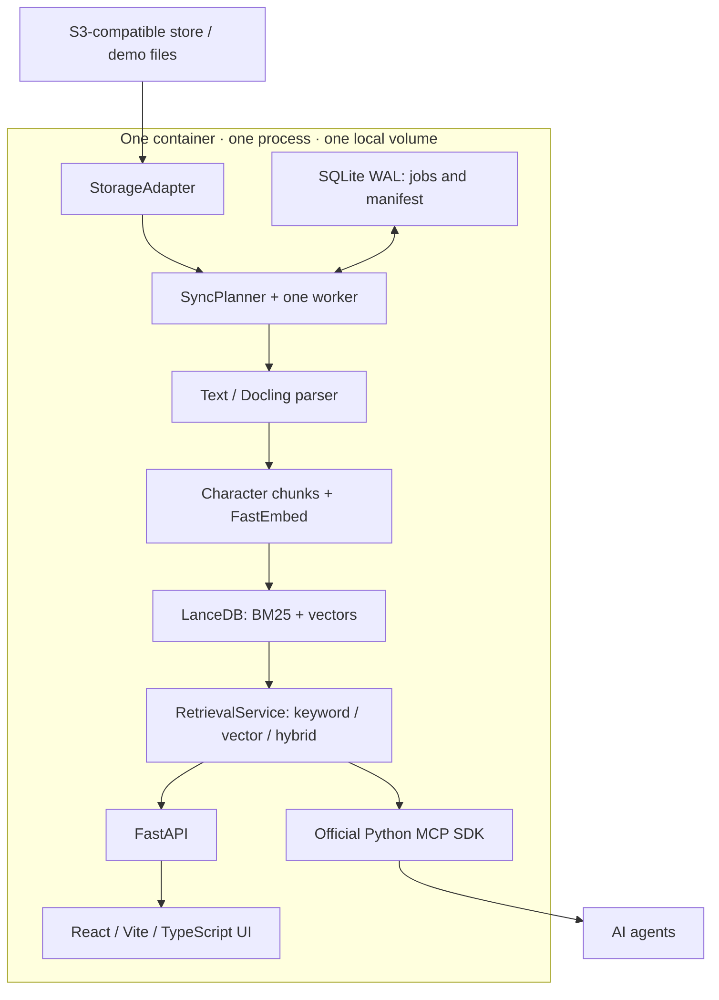

# agent-bucket

**Make your object store searchable by AI agents.**

[](https://github.com/Sanjeev-Karthick/agent-bucket/actions/workflows/ci.yml)
[](LICENSE)
[](pyproject.toml)

A lightweight retrieval sidecar for existing S3-compatible object stores. Sync a
bucket prefix, then retrieve source-backed chunks through REST, MCP or a small web
console. Keep your source objects where they are; parsed text and vectors live in a
local derived index.

**Status: V0.1 starter / developer preview. Single-node first, scale-out by design.**
This repository supplies a runnable foundation and an explicit hardening roadmap.
It is not a stable production release. No throughput or scale claims have been published.

## The problem

Your knowledge already lives in an object store. Giving an agent useful context
often means writing custom ingestion code and running a separate search stack.
agent-bucket packages those boundaries into a sidecar you can inspect, run and extend.

## Quickstart: offline demo

Prerequisites: Docker Engine + Compose, or Python 3.12, uv, Node 22.13+ and npm.

```sh
git clone https://github.com/Sanjeev-Karthick/agent-bucket.git
cd agent-bucket
cp .env.example .env
docker compose up --build -d
```

Open http://localhost:8000. Use the token from `.env`
(`local-demo-token-change-me` for the supplied demo), click **Sync source**, then
search **How do I rotate access keys?**. Results include source URI, chunk and score.
The initial image build installs optional ML/parser packages and may take several minutes.

**The default demo uses hash vectors: lexical fixtures, not semantic embeddings.**
It needs no model downloads. BM25 works normally; vector/hybrid modes exercise the
pipeline with fixture vectors. Enable FastEmbed before evaluating semantic retrieval.

Without Docker:

```sh
make setup
make build
make demo
```

Open http://localhost:8000. For UI development, run `make ui` in another terminal
and open the Vite URL; its `/v1` requests proxy to the backend. Sync is explicit:
the service does not ingest or schedule jobs automatically.

## Demo from the API

```sh
export AB_API_TOKEN=local-demo-token-change-me
curl -sS -X POST http://localhost:8000/v1/sync \
  -H "Authorization: Bearer $AB_API_TOKEN"
curl -sS http://localhost:8000/v1/jobs \
  -H "Authorization: Bearer $AB_API_TOKEN"
```

Wait for the job to report `succeeded`, then query:

```sh
curl -sS http://localhost:8000/v1/search \
  -H "Authorization: Bearer $AB_API_TOKEN" \
  -H 'Content-Type: application/json' \
  -d '{"query":"rotate access keys","mode":"keyword","limit":3}'
```

Interactive REST reference: http://localhost:8000/docs. `GET /v1/status` reports the
source, embedder and counts. `POST /v1/sync` returns a durable job; concurrent active
sync requests share the same job. `GET /v1/jobs/{id}` reports progress at completion.

## Connect an agent through MCP

Use a client supporting **Streamable HTTP** at `http://localhost:8000/mcp/` and set
`Authorization: Bearer <AB_API_TOKEN>` in its request headers. Client configuration
syntax varies; do not put production secrets in committed client configuration.

Tools: `bucket_status` and `search_objects`. Example `search_objects` arguments:

```json
{"request":{"query":"rotate access keys","mode":"hybrid","limit":5}}
```

Both tools are retrieval-only. Starting a sync uses the operator REST API/UI. Treat
retrieved content as untrusted input, preserve citations and keep authorization
decisions outside document instructions.

## Use your S3-compatible store

Install real inference and parsing for a local development deployment:

```sh
uv sync --frozen --extra dev --extra inference --extra parsing
```

Set the following in `.env`, provide read-only credentials via boto3's standard
credential chain, then run `make dev`. The Docker image already includes both extras.

```dotenv
AB_SOURCE=s3
AB_S3_BUCKET=your-knowledge-bucket
AB_S3_PREFIX=docs/
# Omit AB_S3_ENDPOINT for AWS S3; set it for a compatible provider.
AB_EMBEDDING_PROVIDER=fastembed
AB_DATA_DIR=.data-real
AB_API_TOKEN=replace-with-a-long-random-secret
```

Use a fresh data directory when changing source, model, dimensions or chunking.
For Compose, choose a new named data volume in `compose.yaml`; host `AB_DATA_DIR`
does not override its `/data` mount. Model downloads occur on first use. Check
[operations](docs/operations.md) for configuration, backup and troubleshooting and
[SECURITY.md](SECURITY.md) before using private data.

## Architecture



See [architecture](docs/architecture.md) and [ADRs](docs/adr/0001-single-node-first.md)
for job recovery, publication semantics and adapter boundaries.

## Current scope

| Included in the starter | Boundaries / next work |
| --- | --- |
| One configured bucket/prefix or demo directory | One trusted operator; no per-object ACLs or tenants |
| Incremental explicit sync; reconciliation of deleted objects | No scheduler, notifications or whole-corpus snapshots |
| UTF-8 text/Markdown; optional Docling PDF/DOCX/HTML adapter | Real parser/model acceptance is a pre-release task; OCR disabled |
| Embedded BM25, exact vector scan, RRF hybrid ranking | No ANN tuning, distributed shards or reranker service |
| SQLite WAL jobs, startup requeue, single-process lock | No distributed leases, HA or multi-worker deployment |
| REST, MCP, UI; bearer auth | Remote gateway, rate limits and parser isolation need hardening |

The byte/object caps are input limits, not a tested capacity or a performance promise.
Index data is a sensitive derived copy; deletion does not purge historical snapshots/backups.

## Scale-out story

V0.1 has a vertical ceiling: one machine's CPU, RAM and disk. Clear `StorageAdapter`,
`JobRepository`, `SyncPlanner` and `RetrievalService` boundaries leave room to later
separate indexing and query workers. That work still requires an external control
plane, leases/fencing, immutable index generations and consistent query publication.
Running several replicas against the local volume is unsupported. Read the
[roadmap](ROADMAP.md) for the proposed path and unresolved design work.

## Develop and contribute

```sh
make setup
make check
docker compose -f compose.minio.yaml up -d
make integration
```

The default suite uses synthetic data and no model downloads. See
[test coverage and MinIO plan](docs/testing.md), [benchmark methodology](benchmarks/README.md),
[contribution guide](CONTRIBUTING.md), [starter issues](docs/good-first-issues.md),
[release checklist](docs/release-checklist.md) and [launch workspace](docs/launch/product-hunt.md).

```text
backend/agent_bucket/   adapters, control state, worker, retrieval, REST/MCP
frontend/              React console, component tests, build tooling
tests/                 unit/API tests and MinIO integration harness
examples/demo-data/    synthetic, safe-to-share demo corpus
scripts/               local MinIO data seeding
benchmarks/            repeatable harness and methodology; no claimed results
docs/                  architecture, ADRs, operations, release and launch notes
.github/               CI, issue/PR templates, dependency updates
```

Licensed under [Apache-2.0](LICENSE). Community help: [SUPPORT.md](SUPPORT.md).
Please follow our [code of conduct](CODE_OF_CONDUCT.md). Report vulnerabilities
privately using [SECURITY.md](SECURITY.md).
