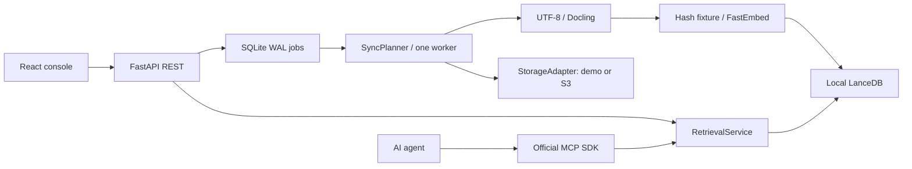

# Architecture

V0.1 is one container, one Uvicorn process, one worker loop and one local data volume.
Run exactly one instance for a data directory. An advisory lock rejects a second
process. Python 3.12 on Linux/macOS is supported; use WSL2 or Docker on Windows.

## Boundaries

`StorageAdapter` inventories and conditionally reads objects; it never writes the source.
`JobRepository` owns control state, object fingerprints and durable sync jobs.
`SyncPlanner` decides changes, parses, chunks, embeds and reconciles deletions.
`RetrievalService` owns LanceDB access and query ranking. REST and MCP use the same
service. The UI calls REST only. HTTP handlers do not contain ingestion logic.

## Control state and recovery

SQLite uses WAL, FULL synchronous writes and per-operation transactions. Enqueue
deduplicates concurrent active sync requests using a partial unique index. One
worker claims work; startup requeues interrupted jobs. Completed jobs remain in the
database; the API shows the most recent 50. No automatic job retention is implemented.

The initial full inventory must succeed before reconciliation starts. Each changed
object is parsed before its manifest is marked pending. Index replacement is serialized
with queries. Its final fingerprint is committed only after the replacement succeeds.
An interrupted replacement is retried on the next sync. Pending entries also permit
cleanup if an object disappears before retry. Already completed object updates remain
visible when a later object fails. There is no whole-corpus atomic snapshot.

S3 ETags are opaque change tokens, not content hashes. Reads use `IfMatch`; listing
and reads are not one snapshot. A concurrent change can fail the job; enqueue another
sync after resolving it. Deletions reconcile only after successful processing.
Unsupported suffixes are counted as skipped. Empty parsed files have zero chunks.

Changing source identity, embedder/model/dimensions or chunking requires a new data
directory. There is no in-place schema migration or re-embedding command yet.

## Retrieval

Native LanceDB FTS supplies BM25. Vectors use an exact scan for this starter; there
is no trained ANN index. Hybrid search uses explicit text/vector queries and reciprocal
rank fusion. Vector scores are `1 - cosine distance`; BM25 and RRF scores have their
own meanings and must not be compared across modes. Results carry URI, chunk number,
text and deterministic chunk ID. These are citations, not presigned download URLs.

Hash embeddings are deterministic lexical test fixtures. FastEmbed supplies real
embeddings. PDF/DOCX/HTML parsing goes through optional Docling; UTF-8 text/Markdown
uses a direct path. Character chunks are intentionally simple; page-aware citations,
OCR, spreadsheets and images are outside the tested starter scope.

## Limits

One machine's CPU/RAM/disk is the ceiling. The retrieval lock serializes queries and
index changes, including embedding calls. Model initialization is lazy and can make
the first request slow. A full inventory is held in memory, capped by `AB_MAX_OBJECTS`.
No HA, distributed leases, ACL propagation, telemetry exporter or scheduler exists.
Keep the source accessible and re-run sync after a failed job.

See [ADRs](adr/0001-single-node-first.md), [operations](operations.md),
[security](../SECURITY.md) and [roadmap](../ROADMAP.md).
